# Nur Pay

Closed-loop электронный кошелёк для Туркменистана: переводы между
пользователями и офлайн-оплата в магазинах по QR. Деньги двигаются
только внутри платформы. Прототип для презентации, ориентир — Touch 'n Go.

Монорепозиторий из трёх частей:

| папка                  | что это                         | стек                                         |
|------------------------|---------------------------------|----------------------------------------------|
| [`mobile/`](mobile)    | приложение для клиента и мерчанта | Flutter, BLoC (кубиты), dio, go_router       |
| [`backend/`](backend)  | API и книга проводок            | Go, Gin, Postgres, pgx/v5, sqlc, goose       |
| [`admin/`](admin)      | веб-админка                     | React 19, TypeScript, Vite                   |

Спецификация — [`NurPayTZ.md`](NurPayTZ.md).

## Демо

Прототип задеплоен и работает.

API (проверка: `/healthz`):

```
https://nurpay-api.rovshen.com/
```

Админка (React):

```
https://nurpay-admin.rovshen.com/
```

Логин:

```
admin
```

Пароль:

```
4w7R5I9mZOGH8G0IwIWBCIZJ5tnxy1i
```

### Android APK

Сборки уже смотрят на боевой API, их можно ставить сразу. Для
большинства телефонов подходит `arm64-v8a`.

| сборка | для чего |
|--------|----------|
| [nur-pay-arm64-v8a.apk](https://github.com/luxx77/nur-pay-full/raw/main/assets/apk/nur-pay-arm64-v8a.apk) | современные телефоны |
| [nur-pay-armeabi-v7a.apk](https://github.com/luxx77/nur-pay-full/raw/main/assets/apk/nur-pay-armeabi-v7a.apk) | старые 32-битные телефоны |
| [nur-pay-x86_64.apk](https://github.com/luxx77/nur-pay-full/raw/main/assets/apk/nur-pay-x86_64.apk) | эмулятор Android |

Вход: любой туркменский номер (+993 и 8 цифр), код из SMS любой, PIN
задаётся на телефоне.

## Скриншоты

UI на туркменском (латиница). Снято на iPhone 17 Pro.

### Вход

<p>
  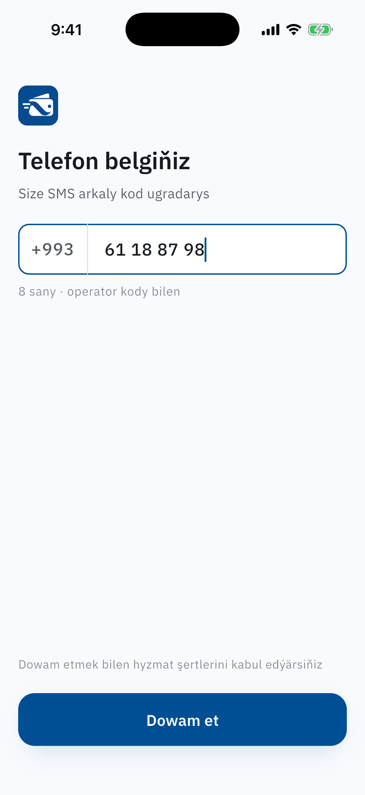
  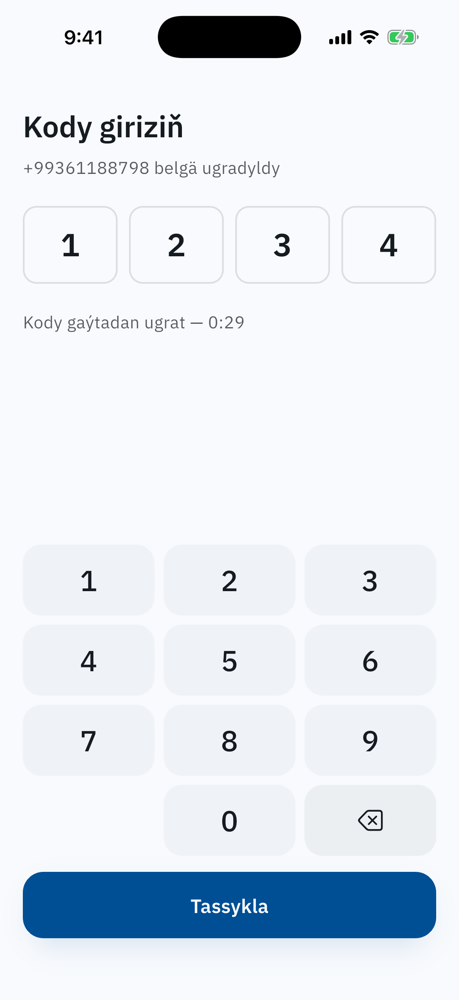
  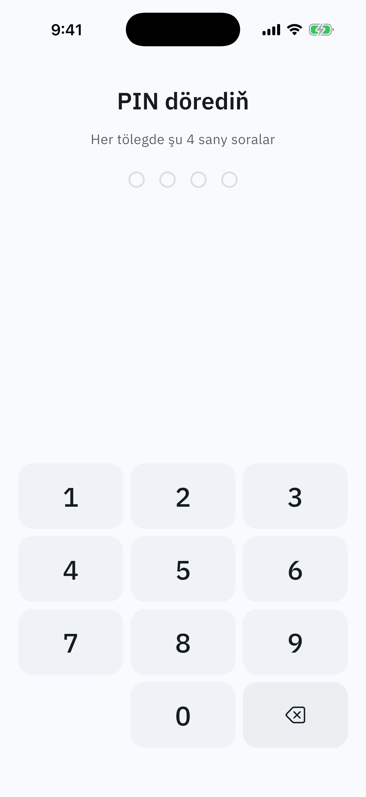
</p>

### Кошелёк

<p>
  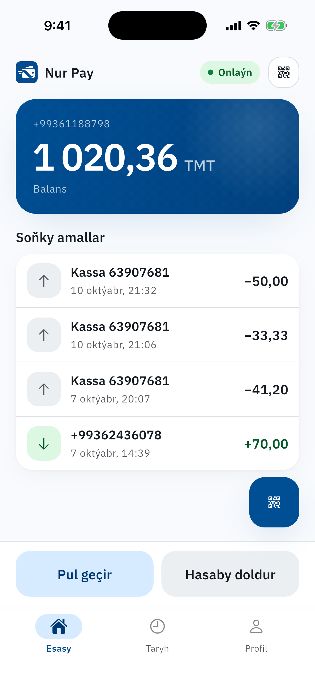
  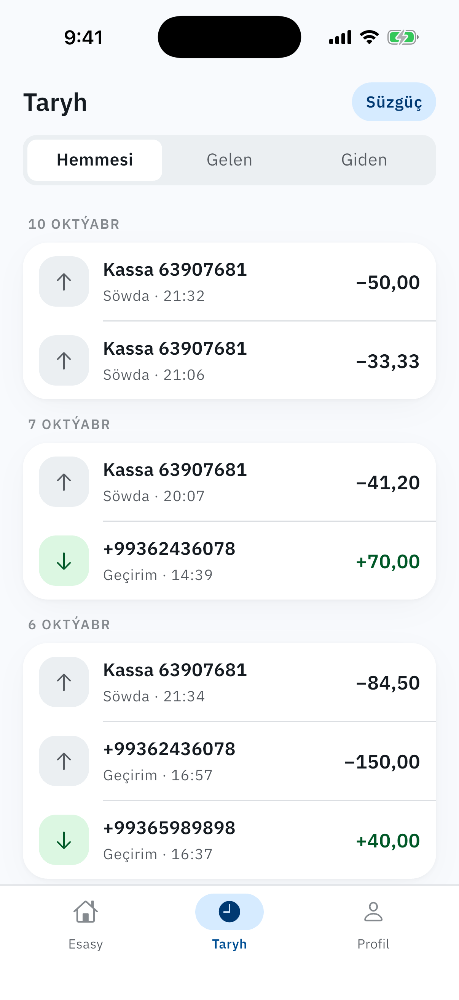
  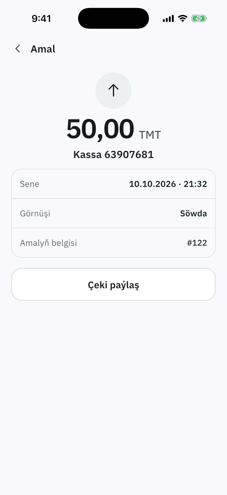
  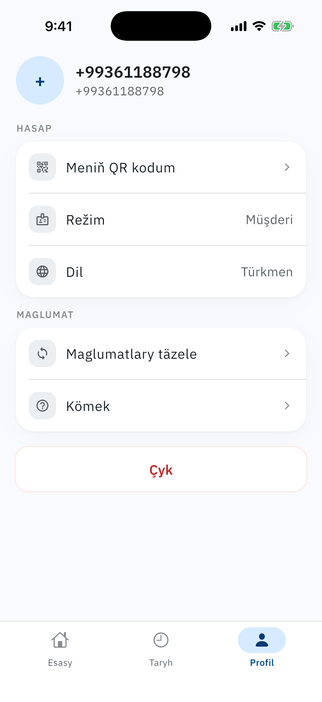
</p>

### Офлайн-оплата в магазинах

Клиент задаёт лимит и подтверждает PIN. Приложение показывает одноразовый
QR и само обновляет его каждые 30 секунд. Код подписывается HMAC прямо на
телефоне, поэтому клиенту интернет не нужен. Касса набирает сумму и
сканирует код.

<p>
  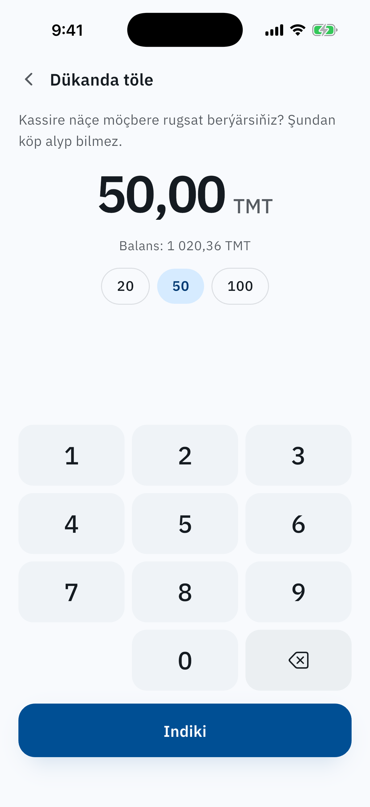
  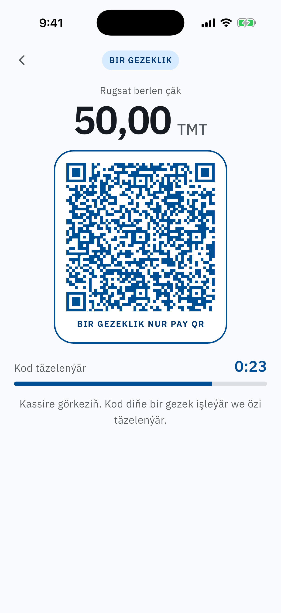
</p>

### Переводы и пополнение

<p>
  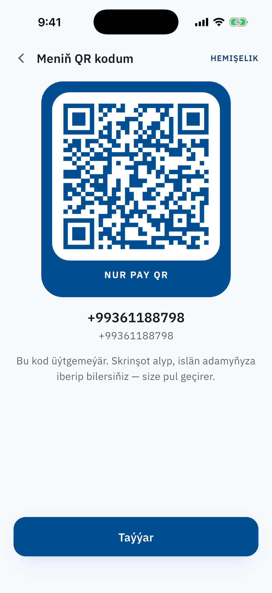
  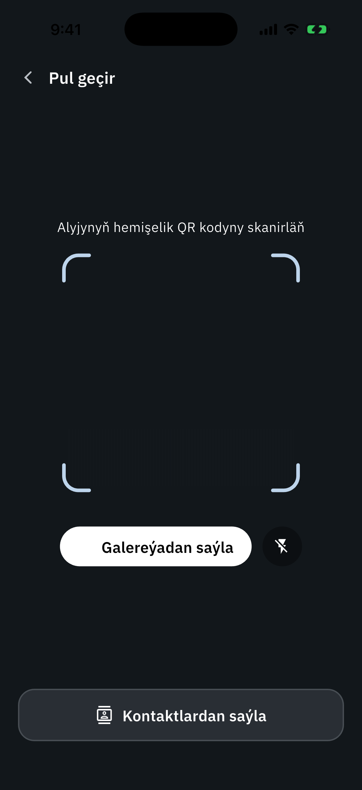
  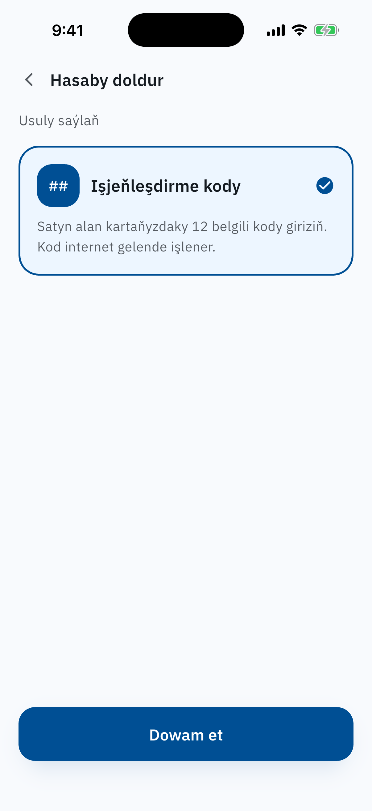
  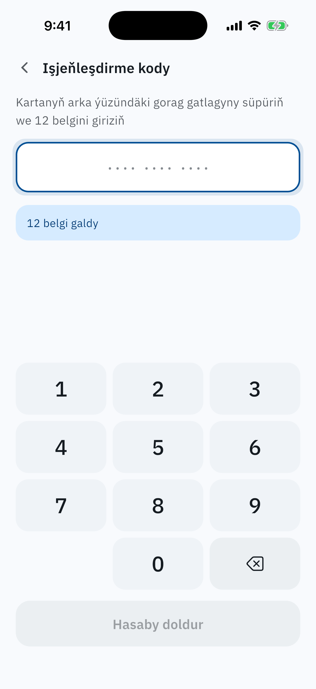
</p>

## Как устроено

* **Деньги** хранятся целыми числами в теңңе (1 манат = 100 теңңе), без
  float.
* **Баланс** нигде не хранится: он считается по книге проводок
  (`ledger`), куда записи только добавляются. Сумма всех балансов,
  включая системные счета эмиссии и комиссий, всегда равна нулю.
* **Списание** идёт одной транзакцией: `SELECT … FOR UPDATE` по
  плательщику, чтение баланса, вставка проводок. Баланс не уходит в минус
  даже при параллельных запросах.
* **Однократность** обеспечивает база, а не код: код активации гасится
  условным `UPDATE`, повторную оплату по одному QR ловит уникальный
  индекс на `nonce`.
* **Комиссию** платит получатель: `floor(amount * percent / 100)`,
  процент задаётся в `.env`.
* **Роль** (клиент или мерчант) определяет сервер. Вкладки и цветовая
  схема приложения следуют за ней.

Подробности — в README каждой части.

## Запуск локально

```bash
# 1. Бэкенд
cd backend
cp .env.example .env
make db-up && make migrate-up && make run   # API на :8080

# 2. Приложение
cd ../mobile
cp .env.example .env    # NURPAY_API_URL=http://localhost:8080
flutter run

# 3. Админка
cd ../admin
cp .env.example .env
npm install && npm run dev
```

Кода из SMS на сервере нет: экран оставлен как шаг сценария, подойдёт
любой. PIN локальный, сервер о нём не знает.

## Как использовался AI

Проект сделан вместе с [Claude Code](https://claude.com/claude-code):
10 из 12 коммитов написаны в паре с ним (видно по `Co-Authored-By` в
истории). Я ставил задачи, принимал архитектурные решения и проверял
результат, а Claude писал код по всем трём частям, ревьюил изменения,
искал баги (нормализация номеров, ключ админки во фронте)
и собрал этот README: сам запустил приложение в iOS-симуляторе,
прошёл экраны и снял скриншоты.
